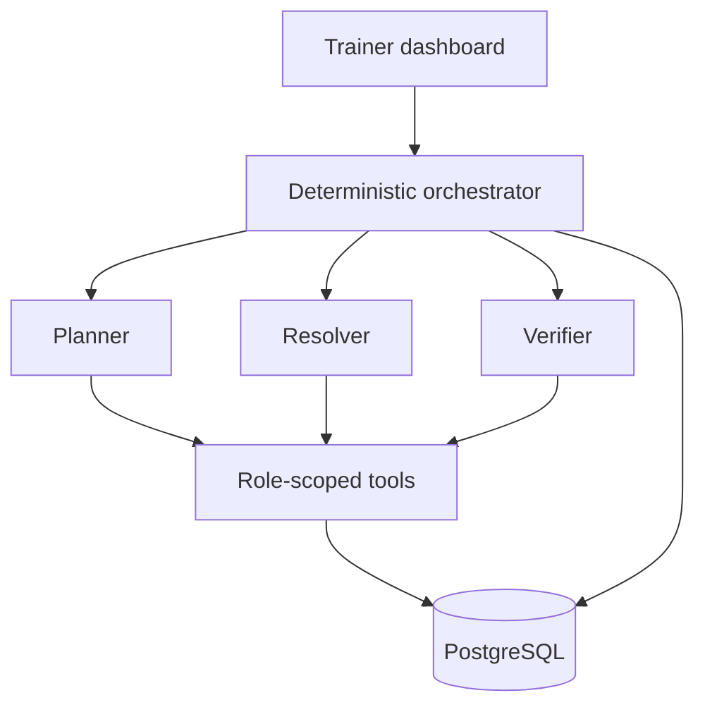

# AgenticLab — IT Support (GH-600)

Educational single-user multi-agent POC: three real Azure OpenAI agents interact through role-scoped tools with a simulated enterprise environment persisted in PostgreSQL.

## Architecture



## Local Windows setup

Prerequisites: Python 3.11+, PostgreSQL, Azure CLI, Azure OpenAI chat model deployment supporting function calling. The signed-in identity needs Cognitive Services OpenAI User on the resource.

Create an empty dedicated database named agenticlab using pgAdmin or psql. Do not use a production database.

```powershell
git clone -b feature/gh600-poc https://github.com/VivaLearning/agenticlab-it-support.git
cd agenticlab-it-support
pwsh -File scripts/setup.ps1
notepad .env
az login
pwsh -File scripts/start.ps1
```

Set DATABASE_URL, AZURE_OPENAI_ENDPOINT, AZURE_OPENAI_DEPLOYMENT and API version in .env. URL-encode special characters in the database password. Never commit secrets. Open http://127.0.0.1:8765.

## Scenarios

- Happy Path: locked account.
- Complex Incident: locked account and invalid session.
- Governance Challenge: shared CRM outage; disruptive restart prohibited.

The agents choose tools dynamically. Replanning is conditional, not guaranteed on each complex run. The verifier checks simulated login independently. Human approval is mandatory for unlocking. The backend rejects shared service restart. The trace and mission state are persisted.

## Tests

```powershell
.\.venv\Scripts\python.exe -m pytest -q
```

## Documentation

- [Installation — Windows and PostgreSQL](docs/installation.md)
- [Azure OpenAI resource configuration](docs/azure-setup.md)
- [Architecture](docs/architecture.md)
- [Agent and tool contracts](docs/agent-contracts.md)
- [Trainer guide and webinar script](docs/trainer-guide.md)
- [Learner guide and theory](docs/learner-guide.md)
- [Scenarios and acceptance checklist](docs/scenarios.md)
- [Troubleshooting](docs/troubleshooting.md)
- [Glossary](docs/glossary.md)

## Execution modes

Use **Esegui fase** for webinars: automatically runs the current agent until the next role, approval or termination. **Prossimo step** runs one LLM call. **Automatico** runs across roles until approval or termination. After approval explicitly resume. **Pausa esecuzione** stops new calls, not an in-flight request.

## Limitations

Local single-user prototype, not production software. Plain HTML/JS dashboard to minimize setup. One database connection role; role authorization enforced in Python. Token count is actual reported usage; threshold checked between calls, not a hard cap. No cost estimation, real CRM integration or real login tests. End-to-end Azure/PostgreSQL validation required on target environment.
