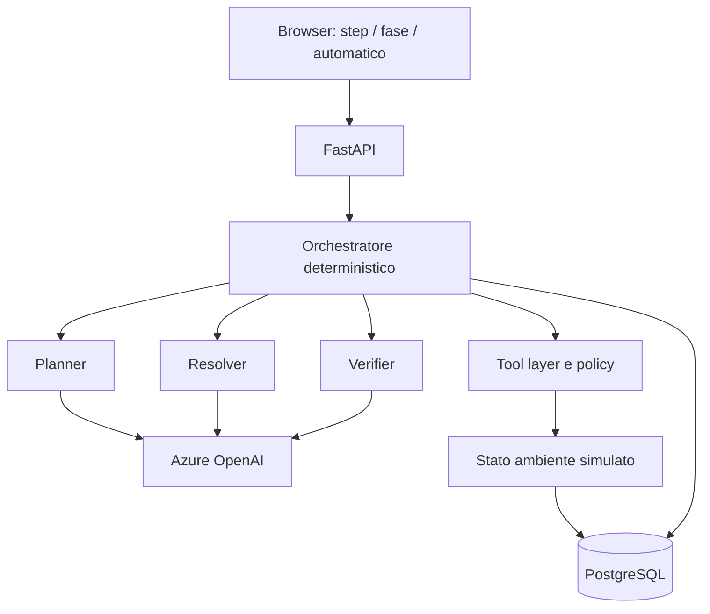
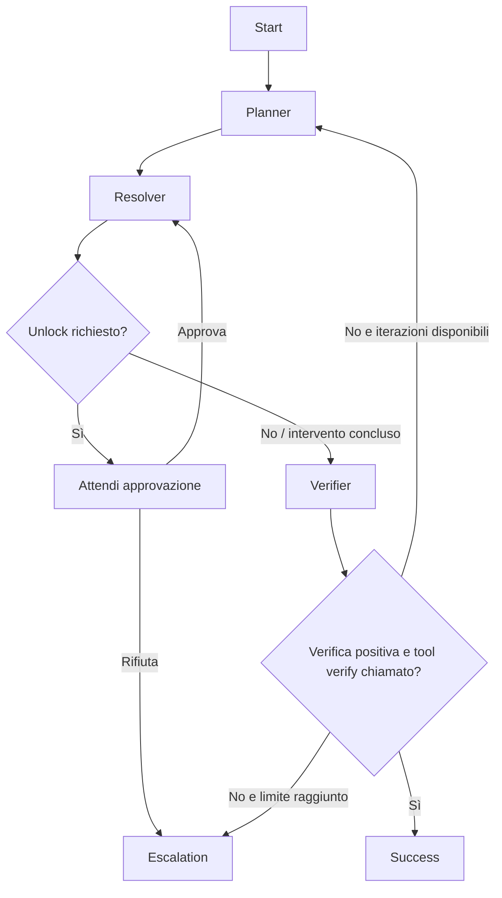

# Architettura tecnica
## Confini
Applicazione single-user locale, FastAPI e HTML/CSS/JS senza build. PostgreSQL persiste lo stato e Azure OpenAI esegue inferenza. Nessun CRM o Identity Provider aziendale reale è contattato.

## File principali
- backend/app.py: API, transazioni, stato, routing e approvazioni.
- backend/llm.py: system prompt distinti, definizioni tool, autenticazione, inferenza e token.
- backend/domain.py: scenari, autorizzazioni, tool e verifica deterministica.
- database/schema.sql: lab_state, lab_run, lab_event.
- frontend/index.html: modalità di avanzamento, trace, stato, note e approvazioni.
- tests/test_domain.py: due test unitari.
## Stato e persistenza
lab_state contiene un unico ambiente JSONB; lab_run conserva missioni, messaggi, evidenze, piano, token e trace; lab_event registra eventi separatamente. Il backend carica lo stato, esegue funzioni Python sul dizionario e salva lo stato nella transazione. I tool non sono singole query SQL autonome. Il reset sostituisce l'ambiente corrente e rende SUPERSEDED le missioni attive precedenti; non cancella la cronologia. Non è previsto il resume di una missione dal browser dopo il reload.
## Routing

Diagramma concettuale: un singolo agente può effettuare più chiamate. Il passaggio effettivo avviene quando restituisce una risposta senza tool call. Il modello sceglie il tool, l'orchestratore sceglie l'agente.
## API
POST /api/start con scenario happy, complex o governance; POST /api/run/{id}/step; POST /api/run/{id}/approval con approved booleano. La fase è un loop client-side che richiama step e si ferma al cambio ruolo o stato. La pausa non annulla una richiesta già inviata.
## Limiti
Massimo 3 iterazioni, 30 chiamate step, soglia token configurabile verificata tra chiamate. Il lock transazionale PostgreSQL serializza le operazioni. La verifica è indipendente per ruolo e controllata dal backend, non un modello diverso. Non ci sono ruoli DB separati, hard budget, autenticazione web, durata garantita o costi monetari calcolati. Non è un sistema produttivo.

## Consolidated reporting
backend/reporting.py builds deterministic summaries from state and trace. New missions retain initial_environment and final_environment snapshots. GET /api/configuration exposes the effective role prompts and allowed tools (no secrets). Export is browser-side JSON of current mission summary and trace. HUMAN_DECISION records approval or rejection. Existing historical runs are not backfilled. The dashboard labels continuity as absence of additional simulated disruptions, independently from CRM availability.
