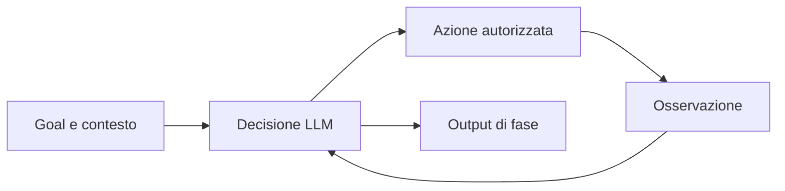

# Manuale del discente — AgenticLab IT Support
Materiale didattico integrativo per GH-600, non materiale ufficiale di certificazione.
## 1. Obiettivi
Al termine saprai distinguere un LLM da un agente, spiegare il ciclo di utilizzo degli strumenti, interpretare un handoff tra agenti, descrivere il ruolo dell'orchestratore, riconoscere guardrail e verificare un criterio di successo.
## 2. Da software tradizionale a sistema agentico
Un programma tradizionale esegue istruzioni stabilite dal codice. Un'applicazione LLM può produrre una risposta probabilistica, ma da sola non modifica un sistema esterno. Un agente aggiunge un obiettivo, un contesto, strumenti invocabili e la possibilità di scegliere azioni in base alle osservazioni. Un sistema multi-agentico distribuisce responsabilità tra ruoli specializzati. Non implica necessariamente maggiore qualità: aggiunge complessità, costo e latenza.
Esempio: un chatbot suggerisce di sbloccare l'account; il Resolver chiede al backend di eseguire il tool unlock. Il backend controlla l'autorizzazione prima di cambiare lo stato.
## 3. Obiettivi, vincoli e ambiente
Il goal è ripristinare l'accesso al CRM. Il vincolo è non interrompere gli altri utenti. Le condizioni iniziali sono note al simulatore, ma gli agenti le scoprono tramite tool. Nel Complex Incident l'account è bloccato e la sessione non valida, mentre il CRM è online. Il successo richiede sia login valido sia continuità. Una singola operazione riuscita non dimostra che il goal è raggiunto.
## 4. Anatomia dell'agente
Un agente comprende istruzioni di ruolo (system prompt), modello, contesto corrente, strumenti e un ciclo di interazione. Il modello è condiviso tra i tre agenti del laboratorio, ma prompt e strumenti differiscono. Non si tratta di tre deployment o tre modelli differenti. Il ruolo specializzato riduce il perimetro delle decisioni.
## 5. Function calling
Il backend invia al modello descrizioni e schemi degli strumenti. Il modello può rispondere con testo oppure con una richiesta strutturata di chiamata. Il backend interpreta la richiesta, controlla il ruolo, esegue la funzione e aggiunge un messaggio tool associato al call ID. Alla chiamata successiva il modello riceve la nuova osservazione. Il modello non esegue SQL e non possiede credenziali PostgreSQL.
Esempio: il tool account restituisce locked=true; service restituisce online=true e active_users=42. Queste sono osservazioni dell'ambiente, non semplici affermazioni del modello. Il tool layer legge lo stato caricato dal database; le modifiche sono persistite dal backend.
## 6. Agentic loop

La fase può richiedere più iterazioni del ciclo. Il pulsante Prossimo step esegue una singola chiamata LLM e l'eventuale tool. Esegui fase ripete automaticamente questi step fino a un confine didattico. Automatico attraversa le fasi fino a un arresto. Una iterazione di missione è invece un ciclo Planner–Resolver–Verifier.
## 7. Orchestrazione
L'orchestratore è codice deterministico: non delega al modello la decisione di quale agente attivare. Al termine del Planner trasferisce il piano al Resolver; dopo il Resolver attiva il Verifier. Se il controllo fallisce riparte dal Planner entro i limiti. Questo è un pattern sequenziale con feedback, non esecuzione parallela o dibattito tra agenti. Il routing può essere implementato anche con un agente in altri sistemi, ma qui è deliberatamente prevedibile.
## 8. Memoria e contesto
Il contesto è ciò che viene effettivamente inviato al modello. Lo stato persistente è più ampio: contiene piano, trace, evidenze e messaggi. Conservare un dato nel database non significa che il modello lo conosca. L'orchestratore decide cosa trasferire. In questo POC i messaggi vengono reinizializzati al cambio agente; il piano o resoconto viene trasferito e le evidenze vengono reinviate quando si ripianifica. Non c'è una memoria semantica vettoriale né RAG.
## 9. Governance
Un prompt suggerisce un comportamento ma non garantisce che venga rispettato. Il backend deve imporre le regole. Planner e Verifier non possono sbloccare l'account. Il Resolver deve ottenere approvazione per unlock; restart viene negato. Human-in-the-loop significa che un essere umano prende una decisione rilevante prima dell'effetto. Least privilege significa concedere soltanto gli strumenti necessari al ruolo: qui è applicato in Python, non tramite tre account DB.
Il blast radius rappresenta l'impatto potenziale di un'azione: riavviare un servizio condiviso può colpire altri utenti, mentre rigenerare una sessione individuale ha un perimetro più limitato. Il POC vieta sempre il restart.
## 10. Verifica e ripianificazione
Il Verifier ha un compito diverso dal Resolver. Il backend esige il tool verify e ricalcola login e continuity. Se il Resolver sblocca l'account ma non ripristina la sessione, il login rimane falso. L'orchestratore passa le evidenze al Planner per un nuovo piano. Se entrambi i problemi vengono individuati subito e risolti al primo giro, è un successo valido: non forziamo una seconda iterazione. Se il goal è irraggiungibile, il sistema termina entro i limiti anziché continuare all'infinito.
## 11. Osservabilità
La trace registra missione, risposte LLM, tool selezionati, osservazioni, handoff, approvazione ed esiti espliciti dove implementati. È una descrizione delle operazioni osservabili, non accesso ai pensieri interni del modello. Il contatore token mostra il consumo riportato dal provider. Il costo dipende dalle tariffe di input/output e non è calcolato dal POC. MAX_TOKENS è controllato tra chiamate e può essere superato dall'ultima richiesta. Non rappresenta un hard budget.
## 12. Scenari da esplorare dopo il webinar
| Scenario | Cosa osservare |
|---|---|
| Happy Path | Account bloccato, sessione valida, approvazione e verifica |
| Complex Incident | Due anomalie, diagnosi e possibile ripianificazione |
| Governance Challenge | CRM offline, azione globale vietata, escalation o limite |
L'ordine dei tool può variare: valutare evidenze e risultato, non una sequenza identica a quella del docente. Dopo un'approvazione negativa il sistema termina in ESCALATED.
## 13. Autovalutazione (studio individuale)
1. Chi sceglie il prossimo agente? L'orchestratore.
2. Chi sceglie il tool? Il modello, entro il catalogo del ruolo.
3. Chi esegue la funzione? Il backend.
4. Perché il successo di unlock non basta? La sessione o il CRM potrebbero essere ancora non disponibili.
5. Il modello vede automaticamente tutto PostgreSQL? No.
6. Perché separare verifica ed esecuzione? Per ridurre il rischio di accettare un resoconto non comprovato.
7. Un prompt è un guardrail sufficiente? No: servono controlli applicativi.
8. Perché due run possono avere trace diverse? Le decisioni LLM non sono una procedura fissa.
## 14. Dal POC alla produzione
Servirebbero identità e autorizzazioni reali, tool validati, isolamento per utente e missione, protezione da prompt injection, timeout e retry controllati, monitoraggio dei costi, valutazioni e test di regressione, gestione dei dati personali. MCP potrebbe standardizzare l'accesso agli strumenti in un'estensione futura; non è implementato qui.
Approfondimenti: [architettura](architecture.md), [contratti agenti](agent-contracts.md), [scenari](scenarios.md), [glossario](glossary.md).

## 15. Reading the consolidated dashboard
Mission Summary is computed by Python, not written by the LLM. Compare initial/current state and inspect the token usage by agent. CRM offline and zero additional disruptions may coexist. Escalation is a terminal state, not a real notification or monitoring service. Agent configuration exposes actual prompts and permitted tools; JSON export preserves evidence for comparison. A stronger prompt helps but cannot guarantee correctness; verification remains necessary.
